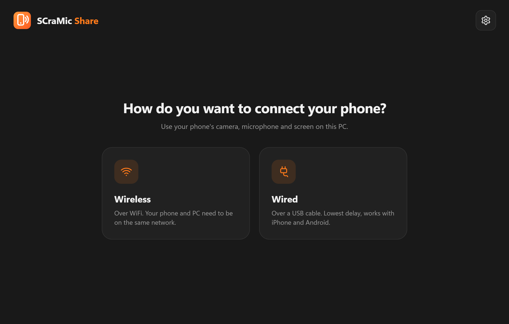
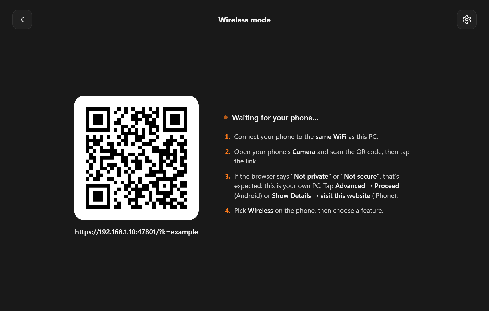
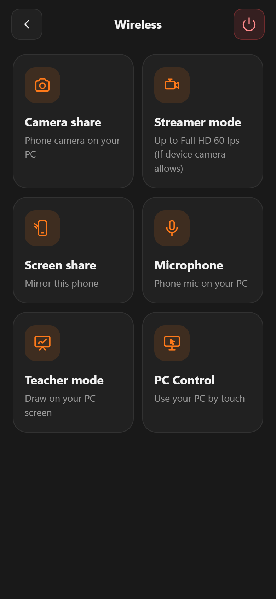
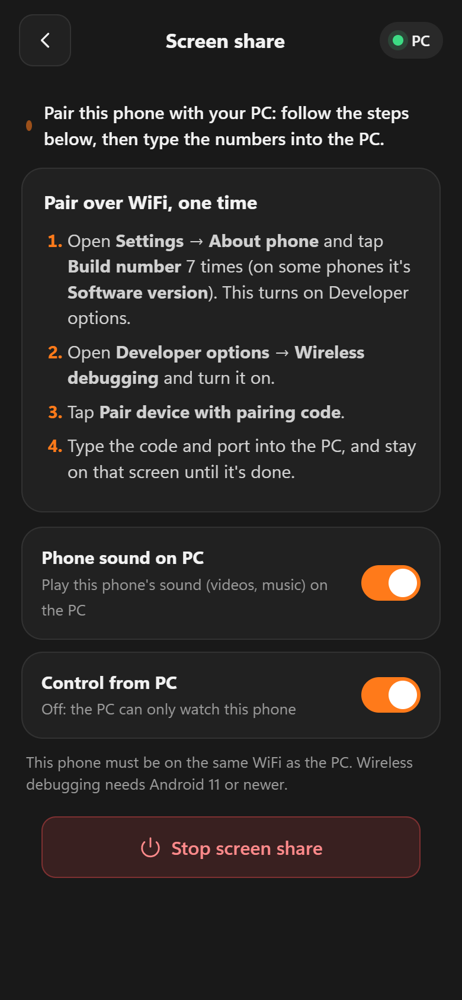
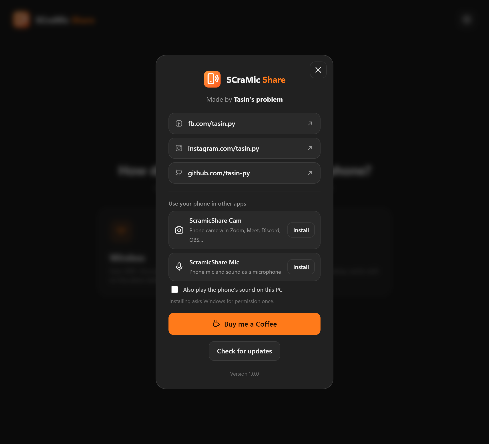

<div align="center">


# SCraMic Share

**Turn your phone into a webcam, microphone, screen share, whiteboard and remote control for your Windows PC.**

Works with iPhone and Android, over WiFi or USB. Nothing to install on the phone.

[](https://github.com/tasin-py/SCraMic-Share/releases/latest)
[](#installation)
[](LICENSE)

[**Download for Windows**](https://github.com/tasin-py/SCraMic-Share/releases/latest) &nbsp;•&nbsp; [Screenshots](#screenshots) &nbsp;•&nbsp; [Features](#features) &nbsp;•&nbsp; [Getting started](#getting-started) &nbsp;•&nbsp; [Privacy](#privacy-and-security)

</div>

---

## Screenshots

<table>
  <tr>
    <td width="50%" align="center"><br><sub>Choose how to connect</sub></td>
    <td width="50%" align="center"><br><sub>Scan the QR code with your phone</sub></td>
  </tr>
</table>

<table>
  <tr>
    <td width="33%" align="center"><br><sub>Pick a feature on your phone</sub></td>
    <td width="33%" align="center"><br><sub>Share your phone's screen</sub></td>
    <td width="33%" align="center"><br><sub>Add ScramicShare Cam and Mic</sub></td>
  </tr>
</table>

## Features

| Feature | What it does |
|---|---|
| **Camera share** | Shows your phone's camera on your PC |
| **Streamer mode** | Up to Full HD 60 fps (if the device camera allows), with resolution and FPS controls on the phone and PC |
| **Microphone share** | Sends your phone's mic to your PC, with a mute button |
| **ScramicShare Cam and Mic** | Lets you pick the phone as your camera and microphone in Zoom, Meet, Discord, OBS and more |
| **Screen share** | Mirrors your phone to the PC, with rotation on iPhone and a share-only option on Android |
| **Teacher mode** | Lets you draw on your PC screen from your phone |
| **PC Control** | Lets you use your PC by touch, or watch only |

Camera share and Streamer mode also have a battery-saving dark screen, with a video on/off button.

## Installation

**Requirements:** Windows 10 or 11 (64-bit), and an iPhone or Android phone with a modern browser.

1. Download `SCraMicShare-Setup-x.x.x.exe` from the [latest release](https://github.com/tasin-py/SCraMic-Share/releases/latest).
2. Run it. It installs just for you and doesn't need administrator rights.

> [!NOTE]
> The app isn't code-signed yet, so Windows may show **"Windows protected your PC"**. Click **More info**, then **Run anyway**. You can compare the file with the SHA-256 listed on the release first.

The app checks for new versions each time it starts and tells you when one is available.

## Getting started

### Wireless

1. Connect your phone and PC to the same WiFi.
2. Open SCraMic Share, click **Wireless**, and scan the QR code with your phone.
3. If the browser warns "Not private" or "Not secure", that's expected, because the page comes from your own PC. Tap **Advanced → Proceed** on Android, or **Show Details → visit this website** on iPhone.
4. Pick a feature on your phone.

### Wired

Click **Wired** and follow the steps on screen.

- **Android:** needs USB debugging turned on.
- **iPhone:** works through Personal Hotspot over the cable.

> [!TIP]
> On iPhone we recommend Wireless, because it's much more stable than Wired.

### Screen share

| Phone | Connection | How to start |
|---|---|---|
| **iPhone** | WiFi | Open Control Center → Screen Mirroring → **SCraMicShare**. The first time, the app downloads a free AirPlay receiver. |
| **Android** | USB | Your screen opens on the PC by itself. |
| **Android 11 or newer** | WiFi | Pair once using **Developer options → Wireless debugging → Pair device with pairing code**, then type the code and port into the PC. |
| **Older Android** | WiFi | Use Windows' Wireless Display. |

### ScramicShare Cam and Mic

In the app, open **Settings** and click **Install** next to each one. Windows asks for permission once. Then pick them as the camera or microphone in your other apps.

## Privacy and security

- **Your video and sound stay on your own network or cable.** There's no account and no cloud service.
- **Pairing:** the phone connects using a private key inside the QR code, so only share that code with devices you trust.
- **Update check:** each time it starts, the app asks GitHub for the list of releases. GitHub sees your internet address, as with any website. The app never installs anything by itself.
- **Wireless debugging and USB debugging** let paired computers control your phone. Turn them off when you're on a network you don't trust.
- **Downloads:** some features download [outside tools](#third-party-tools) when first needed. The app only asks for them when you use that feature.

## Third-party tools

These aren't part of this project. They're downloaded when needed, and they have their own licenses.

| Tool | Used for | License |
|---|---|---|
| [UxPlay for Windows](https://github.com/leapbtw/uxplay-windows) | iPhone screen share | GPL-3.0 |
| [scrcpy](https://github.com/Genymobile/scrcpy) | Android screen share | Apache-2.0 |
| [Android Platform-Tools](https://developer.android.com/tools/releases/platform-tools) | Android over USB and WiFi | Google's license |
| [UnityCapture](https://github.com/schellingb/UnityCapture) | ScramicShare Cam | MIT |
| [VB-CABLE](https://vb-audio.com/Cable/) | ScramicShare Mic | Donationware by VB-Audio |

## Run from source

Needs Python 3.10 or newer on Windows. Install the libraries once:

```bash
pip install -r requirements.txt
```

Then start the app:

```bash
python scramicshare.py
```

You can also start it by double-clicking `Start SCraMic Share.bat`.

## Support the project

If SCraMic Share is useful to you, you can support it from **Settings → Buy me a Coffee** in the app, or here:

- **Bangla QR:** [open the QR code](web/assets/bangla-qr.png)
- **Binance ID:** `741109839`

Found a bug or have an idea? [Open an issue](https://github.com/tasin-py/SCraMic-Share/issues).

## License

SCraMic Share is licensed under the [Apache License 2.0](LICENSE).

Teacher mode is based on [InkCast](https://github.com/ssfshad/inkcast) by ssfshad, also under Apache-2.0. See [NOTICE](NOTICE) for details.

<div align="center">

Made by **Tasin's problem** &nbsp;•&nbsp; [GitHub](https://github.com/tasin-py) &nbsp;•&nbsp; [Facebook](https://fb.com/tasin.py) &nbsp;•&nbsp; [Instagram](https://instagram.com/tasin.py/)

</div>
